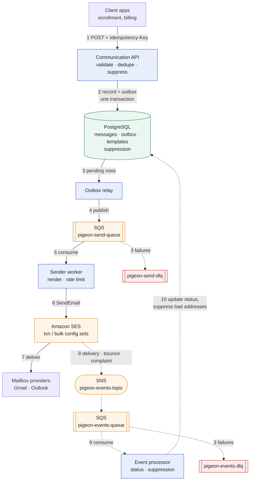
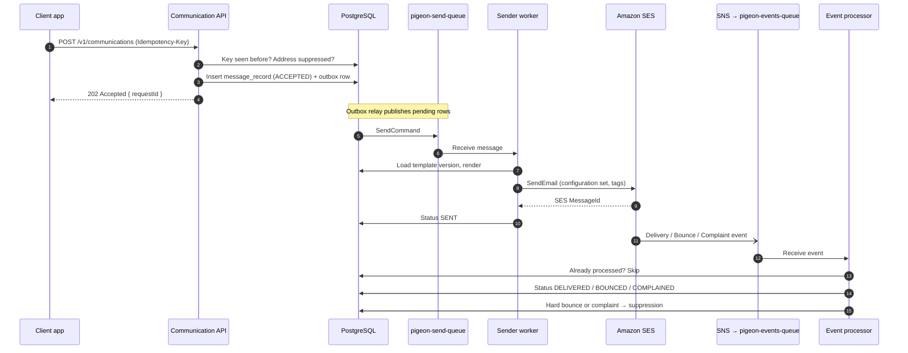

# Pigeon
**Trusted delivery, built on AWS SES.**

An enterprise transactional email platform built with Java 21 and Spring Boot 3: asynchronous
sending through SQS, event-driven bounce and complaint processing, suppression management,
reputation monitoring, and SPF / DKIM / DMARC domain authentication.

## Build status
| Phase | Scope | Status |
|---|---|---|
| 0 | Project skeleton, Docker, LocalStack resources, health check | Done |
| 1 | Database schema, seeded templates, TemplateRenderer | Done |
| 2 | Communication API: validation, idempotency, suppression check, outbox | Planned |
| 3 | Sender worker calling SES, rate limiting, retries, DLQ | Planned |
| 4 | Event pipeline, suppression rules, local event simulator | Planned |
| 5 | Reputation metrics, suppression API, batch sending | Planned |
| 6 | Structured logging, PII masking, error handling | Planned |
| 7 | Docs, demo scripts, full run-through | Planned |

## Architecture

Solid arrows carry an email out. Dashed arrows carry delivery events back.



### One email, start to finish



### Why it is built this way
| Decision | Reason |
|---|---|
| API returns 202 and queues the work | Callers never wait on SES; open-enrollment spikes are absorbed by SQS |
| Idempotency-Key on every request | A caller retrying after a timeout never sends a member a duplicate email |
| Transactional outbox | The message row and its queue message commit together, so neither can exist without the other |
| Suppression checked before queueing | Known-bad addresses cost nothing and never touch sender reputation |
| Two configuration sets | Transactional and bulk mail keep separate reputations; a bad campaign cannot hurt password resets |
| Dead-letter queue after 3 attempts | Failing messages are kept for inspection and replay, never silently lost |
| Events processed idempotently | SNS delivers at least once; a redelivered bounce must not be counted twice |
| Versioned templates | Every message records the exact wording it was sent with |

### Local vs AWS
| Concern | Local (this repo) | AWS |
|---|---|---|
| SES, SQS, SNS | LocalStack 4.14 on port 4566 | Real services, IAM role credentials |
| Delivery events | `LocalEventSimulator` publishes SES-format events (Phase 4) | SES configuration set event destination → SNS |
| Database | Postgres 16 container | Amazon RDS / Aurora PostgreSQL |
| Domain authentication | Not needed | SPF, DKIM (Easy DKIM), custom MAIL FROM, DMARC |

The full schema is in [docs/SCHEMA.md](docs/SCHEMA.md).

## Prerequisites
- Java 21, Maven 3.9+ (`mvn -v` must show Java 21)
- Docker Desktop, running
- IntelliJ IDEA (optional)

## Start locally (PowerShell)
```powershell
docker compose up -d
docker compose ps                     # wait until both services show "healthy"
mvn spring-boot:run "-Dspring-boot.run.profiles=local"
```
In IntelliJ, use the **Pigeon (local)** run configuration instead of the last line.

## Check it is running
```powershell
# Resources created by localstack/init/ready.d/01-pigeon-resources.sh
docker logs pigeon-localstack 2>&1 | Select-String "pigeon-init"

# Queues, as the app sees them
docker exec pigeon-localstack awslocal sqs list-queues

# Health: status UP, with components.pigeonAws listing every queue and the events topic
curl.exe -s http://localhost:8080/actuator/health
curl.exe -s http://localhost:8080/actuator/info
```

## Tests
```powershell
mvn verify
```
Integration tests start their own Postgres and LocalStack containers (Testcontainers), so Docker
must be running. They reuse the same init script as docker-compose.

## Local AWS resources
| Type | Name | Purpose |
|---|---|---|
| SQS | `pigeon-send-queue` | Requests waiting to be sent; redrives to `pigeon-send-dlq` after 3 attempts |
| SQS | `pigeon-events-queue` | SES delivery events; redrives to `pigeon-events-dlq` after 3 attempts |
| SNS | `pigeon-events-topic` | SES event destination, subscribed by `pigeon-events-queue` |
| SES | `notify.pigeon.local` | Sending domain identity |
| SES | `pigeon-txn-prod`, `pigeon-bulk-prod` | One configuration set per traffic stream |

LocalStack is pinned to `4.14`, the last release that runs without a LocalStack account.
