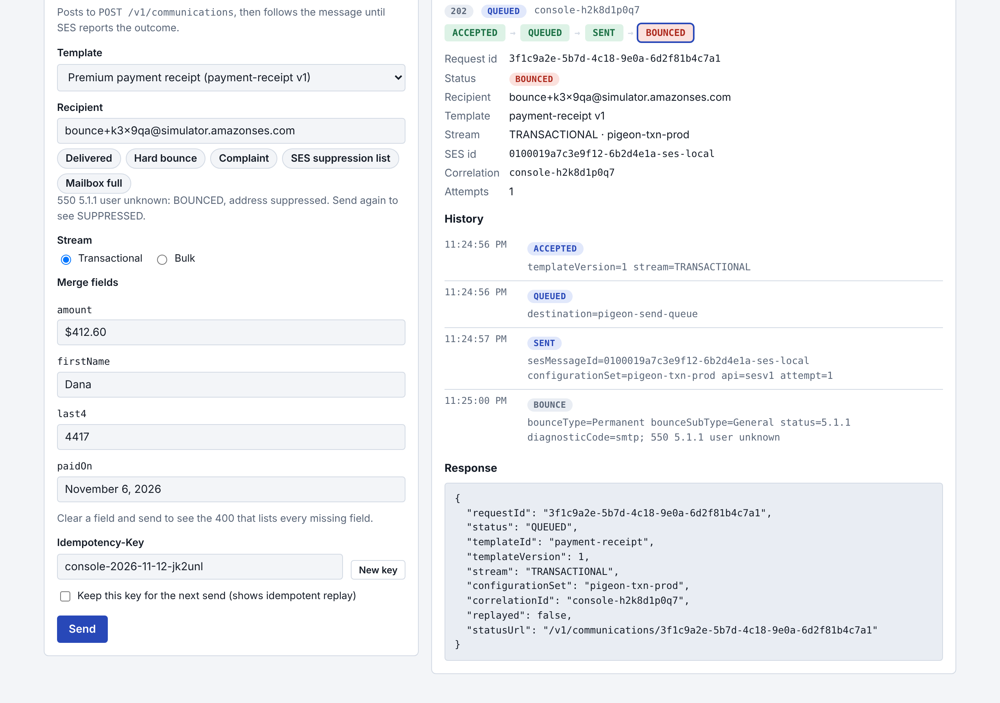
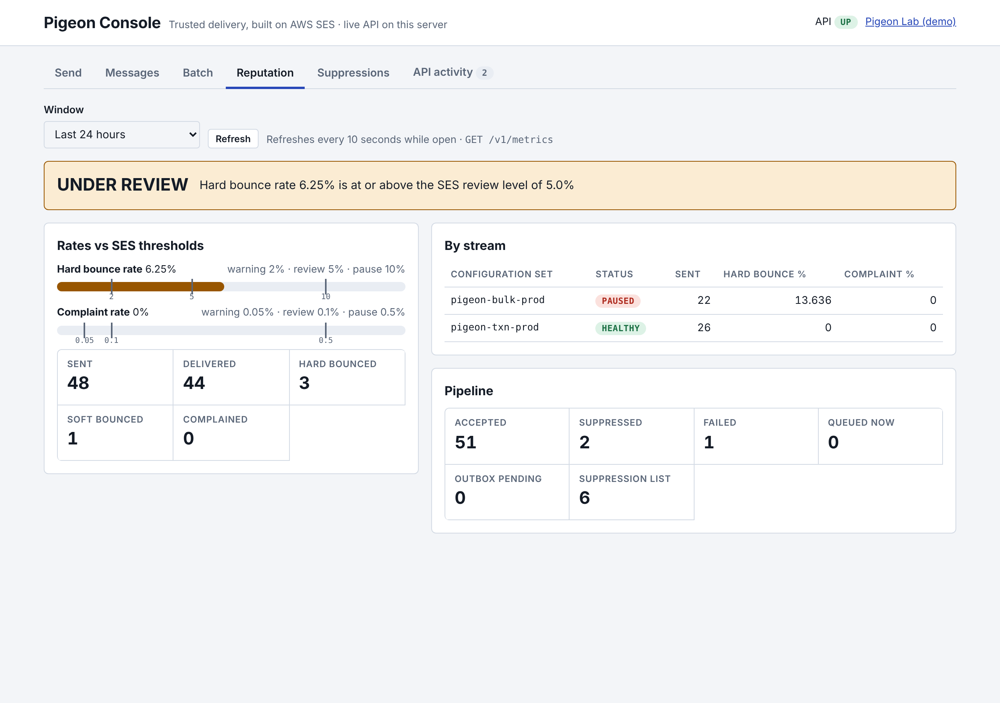
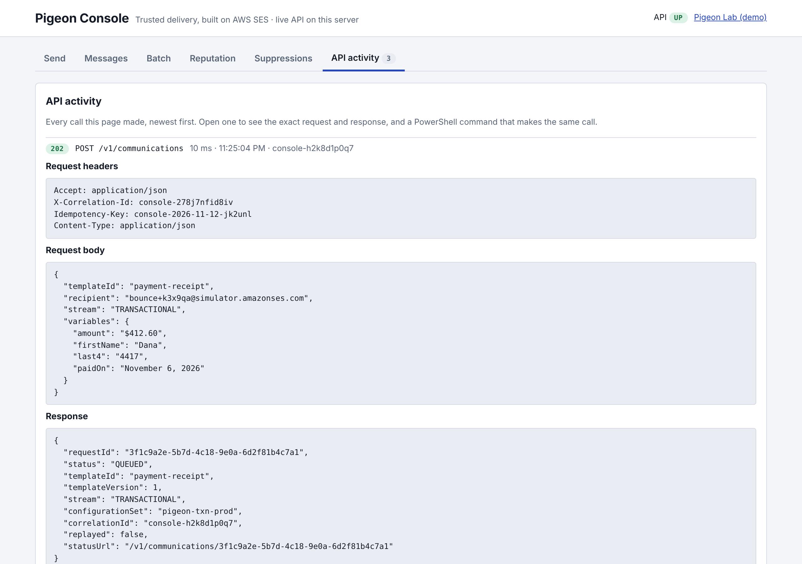
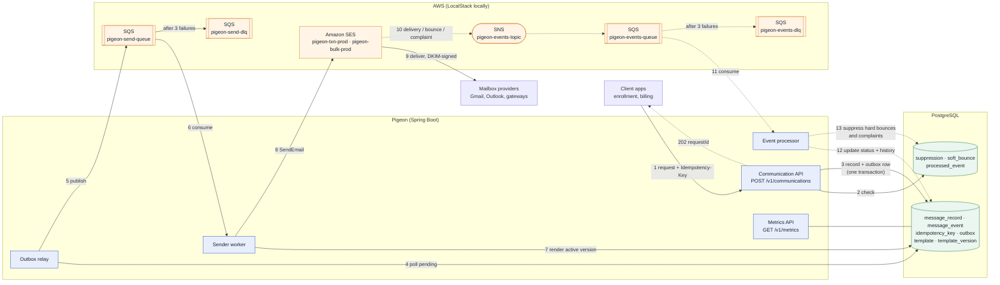
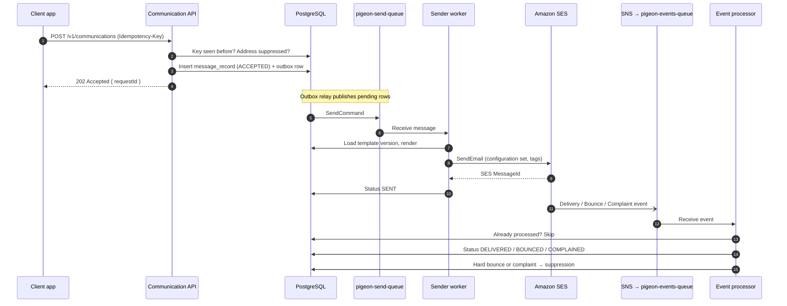

# Pigeon
**Trusted delivery, built on AWS SES.**

An enterprise transactional email platform built with Java 21 and Spring Boot 3: asynchronous
sending through SQS, event-driven bounce and complaint processing, suppression management,
reputation monitoring, and SPF / DKIM / DMARC domain authentication.

## Build status
| Phase | Scope | Status |
|---|---|---|
| 0 | Project skeleton, Docker, LocalStack resources, health check | Done |
| 1 | Database schema, seeded templates, TemplateRenderer | Done |
| 2 | Communication API: validation, idempotency, suppression check, outbox | Done |
| 3 | Outbox relay, sender worker calling SES, rate limiting, retries, DLQ | Done |
| 4 | Event pipeline, suppression rules, local event simulator | Done |
| 5 | Reputation metrics, suppression API, batch sending | Done |
| 6 | Structured logging, correlation ids, PII masking, error handling | Done |
| 7 | Pigeon Console, DNS and AWS docs, scripted run-through of every scenario | Done |

## Pigeon Console (the real API, in a browser)

Start the app and open **http://localhost:8080/console**. Every button calls the live API on this
server; nothing in the page is simulated. (The Pigeon Lab at `/` is a separate, self-contained demo.)

| Tab | What it does | API |
|---|---|---|
| Send | Pick a template and a scenario (Delivered, Hard bounce, Complaint, SES suppression list, Mailbox full), send, and watch the status move ACCEPTED → QUEUED → SENT → outcome | `POST /v1/communications`, `GET /v1/communications/{id}` |
| Messages | Recent messages with a status filter; open one for its full history | `GET /v1/communications?status=&limit=` |
| Batch | Paste `address, firstName` lines; per-item results | `POST /v1/communications/batch` |
| Reputation | Status banner, bounce and complaint rates against the SES thresholds, per stream | `GET /v1/metrics` |
| Suppressions | List, add, remove (complaints ask for confirmation) | `/v1/suppressions` |
| API activity | Every call the page made: request, response and the same call as a PowerShell command | |





Other clients for the same API: `requests.http` (IntelliJ HTTP client), the PowerShell commands
in this README and in the console's API activity tab, or any HTTP tool such as Postman or curl.

## Pigeon Lab (interactive)

Start the app and open **http://localhost:8080/**. This is a self-contained teaching demo with its
own in-browser simulator; it does not call the API (use the Pigeon Console for that). It is served by Pigeon itself
(`src/main/resources/static/index.html`) and runs entirely in your browser:

| Tab | What you can do |
|---|---|
| 1. Architecture | The platform on one page. Select any component to see its job and the requirement it covers |
| 2. Send simulator | Send to the SES mailbox simulator addresses, watch each pipeline step, the SES event JSON, suppression and reputation rates; push a clean or dirty batch |
| 3. Domain authentication | Toggle Easy DKIM, custom MAIL FROM, SPF and the DMARC policy; see alignment, the DNS records and Gmail's header |
| 4. Java code | Reference Spring Boot code for each component, with review notes |
| 5. Lead playbook | Production readiness checklist, numbers to know, risks and interview questions |

## Architecture

Solid arrows carry an email out. Dashed arrows carry delivery events back.

Two versions of the overview are below. Pick the one you prefer and delete the other.

### Option A: detailed (component groups)

Shows which parts are Pigeon code, PostgreSQL and AWS, splits the database into messaging and reputation tables, and includes the Metrics API.



### Option B: simplified (top to bottom)

One straight send path with the event loop returning to the database. Easier to read on a small screen or in a slide.


### One email, start to finish



### Why it is built this way
| Decision | Reason |
|---|---|
| API returns 202 and queues the work | Callers never wait on SES; open-enrollment spikes are absorbed by SQS |
| Idempotency-Key on every request | A caller retrying after a timeout never sends a member a duplicate email |
| Transactional outbox | The message row and its queue message commit together, so neither can exist without the other |
| Suppression checked before queueing | Known-bad addresses cost nothing and never touch sender reputation |
| Two configuration sets | Transactional and bulk mail keep separate reputations; a bad campaign cannot hurt password resets |
| Dead-letter queue after 3 attempts | Failing messages are kept for inspection and replay, never silently lost |
| Events processed idempotently | SNS delivers at least once; a redelivered bounce must not be counted twice |
| Versioned templates | Every message records the exact wording it was sent with |

### Local vs AWS
| Concern | Local (this repo) | AWS |
|---|---|---|
| SES, SQS, SNS | LocalStack 4.14 on port 4566 | Real services, IAM role credentials |
| SES API | v1 `SendEmail` (`pigeon.ses.api=v1`), because LocalStack's free edition returns 501 for SES v2. Custom headers such as List-Unsubscribe are not sent locally | v2 `SendEmail` with headers, tags and configuration set |
| Delivery events | `LocalEventSimulator` publishes SES-format events to SNS after each send | SES configuration set event destination → SNS |
| Database | Postgres 16 container | Amazon RDS / Aurora PostgreSQL |
| Domain authentication | Not needed | SPF, DKIM (Easy DKIM), custom MAIL FROM, DMARC |

The full schema is in [docs/SCHEMA.md](docs/SCHEMA.md).

## Prerequisites
- Java 21, Maven 3.9+ (`mvn -v` must show Java 21)
- Docker Desktop, running
- IntelliJ IDEA (optional)

## Start locally (PowerShell)
```powershell
docker compose up -d
docker compose ps                     # wait until both services show "healthy"
mvn spring-boot:run "-Dspring-boot.run.profiles=local"
```
In IntelliJ, use the **Pigeon (local)** run configuration instead of the last line.

## Check it is running
```powershell
# Resources created by localstack/init/ready.d/01-pigeon-resources.sh
docker logs pigeon-localstack 2>&1 | Select-String "pigeon-init"

# Queues, as the app sees them
docker exec pigeon-localstack awslocal sqs list-queues

# Health: status UP, with components.pigeonAws listing every queue and the events topic
curl.exe -s http://localhost:8080/actuator/health
curl.exe -s http://localhost:8080/actuator/info
```

## Try the API (PowerShell)

Every request needs an `Idempotency-Key`. Reusing a key with the same body returns the original
request; reusing it with a different body returns 422. `requests.http` has the same scenarios for
IntelliJ's HTTP client.

```powershell
# 1. Accept an email (202, status QUEUED)
$body = '{"templateId":"payment-receipt","recipient":"dana@example.com","stream":"TRANSACTIONAL","variables":{"firstName":"Dana","amount":"$412.60","paidOn":"November 6, 2026","last4":"4417"}}'
$r = Invoke-RestMethod -Method Post -Uri http://localhost:8080/v1/communications `
       -Headers @{ "Idempotency-Key" = "demo-001" } -ContentType "application/json" -Body $body
$r

# 2. Same key, same body: same requestId, nothing new is sent
Invoke-RestMethod -Method Post -Uri http://localhost:8080/v1/communications `
  -Headers @{ "Idempotency-Key" = "demo-001" } -ContentType "application/json" -Body $body

# 3. Status and history
Invoke-RestMethod "http://localhost:8080/v1/communications/$($r.requestId)" | ConvertTo-Json -Depth 5

# 4. Missing merge fields (400 listing every missing field)
$bad = '{"templateId":"payment-receipt","recipient":"dana@example.com","stream":"TRANSACTIONAL","variables":{"firstName":"Dana"}}'
try {
  Invoke-RestMethod -Method Post -Uri http://localhost:8080/v1/communications `
    -Headers @{ "Idempotency-Key" = "demo-002" } -ContentType "application/json" -Body $bad
} catch { $_.ErrorDetails.Message }
```

| Response | When |
|---|---|
| `202 QUEUED` | Accepted and written to the outbox |
| `202 SUPPRESSED` | Recipient is on the suppression list; recorded, never sent |
| `202` + `Idempotent-Replayed: true` | Same key and body seen before; original result returned |
| `400` | Missing header, invalid field, unknown template or missing merge fields |
| `404` | Unknown requestId |
| `422` | Same Idempotency-Key reused with a different body |

Errors are `application/problem+json` (RFC 9457) with a stable `type` and details such as `missingFields`.

## Watch an email go out (Phase 3)

After `POST /v1/communications`, the outbox relay publishes the request to `pigeon-send-queue`
within a second, the sender worker renders it and calls SES, and the status becomes `SENT`.
LocalStack keeps every email SES "sent", so you can read it:

```powershell
# Status should move QUEUED -> SENT with an sesMessageId
Invoke-RestMethod "http://localhost:8080/v1/communications/$($r.requestId)" | ConvertTo-Json -Depth 5

# The email itself, as LocalStack's SES received it
(Invoke-RestMethod http://localhost:4566/_aws/ses).messages |
  Select-Object Id, Source, Subject, @{n="To";e={$_.Destination.ToAddresses}} | Format-List
```

| Situation | What Pigeon does |
|---|---|
| SES accepts | `SENT`, `ses_message_id` stored, `SENT` event in history |
| SES throttles, network error, 5xx | Retries after 10s, 20s, 40s (visibility timeout pushed out); `SEND_RETRY` events |
| SES rejects (bad request, unverified domain) | `FAILED` immediately, no retry |
| Retries exhausted (3 attempts) | `FAILED` with the last error |
| Address suppressed after the request was accepted | `SUPPRESSED` at send time, nothing sent |
| Same SQS message delivered twice | Second delivery sees `SENT` (or an active lease) and does nothing |
| Unreadable or unknown message | Thrown 3 times, then SQS moves it to `pigeon-send-dlq` |
| SQS unreachable | Relay keeps rows `PENDING`, pauses up to 30s between tries, `FAILED` after 20 attempts |

## Close the loop: bounces, complaints, suppression (Phase 4)

Locally, `LocalEventSimulator` answers each send the way the SES mailbox simulator would, by
publishing real SES event JSON to `pigeon-events-topic`. The event processor cannot tell it from
the real thing. Send to these addresses (add `+anything` before the `@` to reuse them):

| Recipient | Events | Final status | Suppression |
|---|---|---|---|
| `success@simulator.amazonses.com` (or any normal address) | Delivery | `DELIVERED` | none |
| `bounce@simulator.amazonses.com` | Bounce, Permanent, 5.1.1 | `BOUNCED` | `HARD_BOUNCE` |
| `complaint@simulator.amazonses.com` | Delivery, then Complaint | `COMPLAINED` | `COMPLAINT` |
| `suppressionlist@simulator.amazonses.com` | Bounce, OnAccountSuppressionList | `BOUNCED` | `ACCOUNT_SUPPRESSION_LIST` |
| any address containing `mailboxfull` | Bounce, Transient, 4.2.2 | `BOUNCED` | `REPEATED_SOFT_BOUNCE` on the 3rd within 7 days |

The next request to a suppressed address returns `202` with `"status": "SUPPRESSED"` and is never sent.

How events are handled:
- **Duplicates:** the SNS MessageId is recorded in `processed_event` in the same transaction, so a redelivered event changes nothing.
- **Out of order:** status only moves forward (SENT → DELIVERED → BOUNCED → COMPLAINED); a late Delivery cannot undo a Complaint.
- **Too early:** an event that arrives before Pigeon has recorded `SENT` is retried, not lost.
- **Unknown message:** a bounce or complaint still suppresses the address.

```powershell
# Bounce, then watch the next request get suppressed
$b = '{"templateId":"payment-receipt","recipient":"bounce+demo@simulator.amazonses.com","stream":"TRANSACTIONAL","variables":{"firstName":"Dana","amount":"$412.60","paidOn":"November 6, 2026","last4":"4417"}}'
$r = Invoke-RestMethod -Method Post -Uri http://localhost:8080/v1/communications -Headers @{ "Idempotency-Key" = "bounce-1" } -ContentType "application/json" -Body $b
Start-Sleep -Seconds 3
Invoke-RestMethod "http://localhost:8080/v1/communications/$($r.requestId)" | ConvertTo-Json -Depth 5   # BOUNCED
Invoke-RestMethod -Method Post -Uri http://localhost:8080/v1/communications -Headers @{ "Idempotency-Key" = "bounce-2" } -ContentType "application/json" -Body $b   # SUPPRESSED
```

## Reputation, suppression list and batches (Phase 5)

### Reputation: `GET /v1/metrics`
Judges sending the way SES does: **hard** bounces and complaints divided by emails sent, over a
window (default 24h; `?window=7d` or `?from=...&to=...`). Reported overall and per configuration
set, so you can see which stream is causing trouble.

| Status | Hard bounce rate | Complaint rate | What SES does |
|---|---|---|---|
| `HEALTHY` | below 5% | below 0.1% | nothing |
| `HEALTHY` + `earlyWarning` | 2% or more | 0.05% or more | nothing yet; our own alarm |
| `UNDER_REVIEW` | 5% or more | 0.1% or more | account placed under review |
| `PAUSED` | 10% or more | 0.5% or more | sending may be paused |

Below 20 sends in the window the rates are shown but not judged (`"representative": false`).
Soft bounces are reported separately and do not count, as on SES. The same numbers are exported to
Prometheus at `/actuator/prometheus` (`pigeon_reputation_bounce_rate_percent`,
`pigeon_reputation_status`, `pigeon_outbox_pending` and more) for alarms.

```powershell
Invoke-RestMethod "http://localhost:8080/v1/metrics?window=1h" | ConvertTo-Json -Depth 6
```

### Suppression list: `/v1/suppressions`
| Call | Result |
|---|---|
| `GET /v1/suppressions?reason=HARD_BOUNCE&page=0&size=50` | Newest first |
| `GET /v1/suppressions/{address}` | One entry, or 404 |
| `POST /v1/suppressions` `{"address":"...","detail":"..."}` | 201 added (reason `MANUAL`), 200 if already there |
| `DELETE /v1/suppressions/{address}` | 204; also resets the soft-bounce count |
| `DELETE` of a `COMPLAINT` or `ACCOUNT_SUPPRESSION_LIST` entry | 409 unless `?force=true`: those people asked not to be emailed, or SES will refuse them |

### Batches: `POST /v1/communications/batch`
Up to 1,000 recipients of one template. Each recipient becomes a normal message through the same
validation, suppression and outbox path. Bad rows are reported per item and do not fail the batch;
retrying with the same `Idempotency-Key` queues nothing twice.

```json
{ "templateId": "payment-receipt", "stream": "BULK",
  "sharedVariables": { "amount": "$412.60", "paidOn": "November 6, 2026", "last4": "4417" },
  "recipients": [
    { "recipient": "success+1@simulator.amazonses.com", "variables": { "firstName": "Ana" } },
    { "recipient": "bounce+1@simulator.amazonses.com",  "variables": { "firstName": "Ben" } } ] }
```
Response: `202` with `counts` (`QUEUED`, `SUPPRESSED`, `REJECTED`) and a result per item.

## Logs and tracing (Phase 6)

**One id follows each email everywhere.** Send `X-Correlation-Id` (or let Pigeon create one); it is
returned in the response header, stored on the message, carried on the SQS message and SES tags, and
printed on every log line from the API, the outbox relay, the sender and the SES event processor:

```
2026-11-11T22:58:01.114-05:00  INFO [nio-8080-exec-3] [order-4471] []                c.p.message.CommunicationService : Accepted message 3f1c... for d***@example.com: QUEUED (payment-receipt v1, TRANSACTIONAL)
2026-11-11T22:58:01.632-05:00  INFO [ntainer#0-1-T-1] [order-4471] [3f1c...]          c.pigeon.sender.SendService       : Sent message 3f1c... to d***@example.com via sesv1 (attempt 1, SES id ...)
2026-11-11T22:58:02.215-05:00  INFO [ntainer#1-1-T-1] [order-4471] [3f1c...]          c.p.events.SesEventProcessor      : SES Delivery event for message 3f1c...: SENT -> DELIVERED
```

```powershell
# Follow one request through the logs
mvn spring-boot:run "-Dspring-boot.run.profiles=local" | Select-String "order-4471"
```

- **JSON logs for a log platform:** add the `json` profile (`local,json` locally,
  `SPRING_PROFILES_ACTIVE=json` in production). Lines become Elastic Common Schema JSON, with
  `correlationId` and `messageId` as fields you can filter on.
- **No personal data in logs:** addresses are masked (`d***@example.com`), including addresses
  inside SES error text. Merge values never reach a log or a queue.
- **Errors you can report:** every error response includes `correlationId`; unexpected errors are a
  plain 500 with no stack trace or internal detail, while the full exception is logged.
- **Graceful shutdown:** in-flight requests and SQS messages finish (up to 30s) before the app stops.

## Run every scenario (clean start)

`scripts/run-scenarios.ps1` runs 21 scenarios against the real app and prints PASS or FAIL for each:
health, templates, delivery, idempotent replay, key reuse, validation errors, XML, BULK, hard bounce
and suppression, complaint and forced removal, account suppression list, three soft bounces, batch,
manual suppression, metrics, correlation ids, recent messages, LocalStack's sent mail, and both web pages.

```powershell
# From a clean slate: wipe containers and database, start everything, run, stop the app
.\scripts\run-scenarios.ps1 -CleanStart -StartApp

# Against an app that is already running
.\scripts\run-scenarios.ps1
```

It writes `target\scenario-report.md` and exits with the number of failures. If Windows blocks the
script, run `Set-ExecutionPolicy -Scope CurrentUser RemoteSigned` once.

## Going to AWS

- [docs/DNS.md](docs/DNS.md): SPF, Easy DKIM, custom MAIL FROM, DMARC, alignment and a safe DMARC rollout
- [docs/AWS-DEPLOY.md](docs/AWS-DEPLOY.md): SES identity, sandbox, configuration sets with SNS event
  destinations, queues, least-privilege IAM, RDS, ECS, alarms and production access

## Tests
```powershell
mvn verify
```
Integration tests start their own Postgres and LocalStack containers (Testcontainers), so Docker
must be running. They reuse the same init script as docker-compose.

## Local AWS resources
| Type | Name | Purpose |
|---|---|---|
| SQS | `pigeon-send-queue` | Requests waiting to be sent; redrives to `pigeon-send-dlq` after 3 attempts |
| SQS | `pigeon-events-queue` | SES delivery events; redrives to `pigeon-events-dlq` after 3 attempts |
| SNS | `pigeon-events-topic` | SES event destination, subscribed by `pigeon-events-queue` |
| SES | `notify.pigeon.local` | Sending domain identity |
| SES | `pigeon-txn-prod`, `pigeon-bulk-prod` | One configuration set per traffic stream |

LocalStack is pinned to `4.14`, the last release that runs without a LocalStack account.
