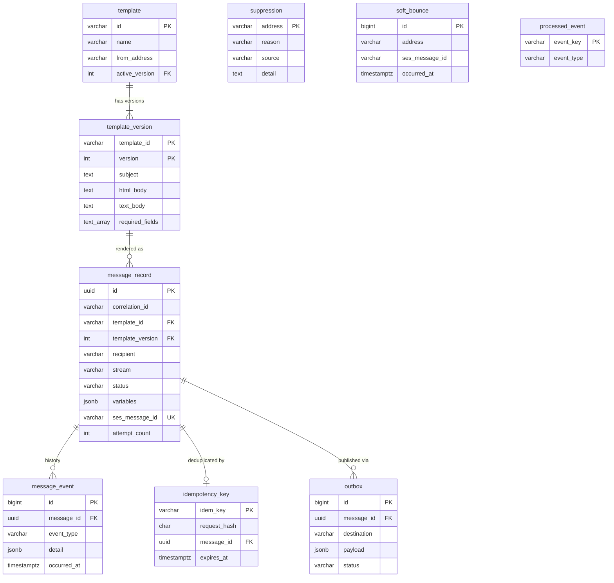

# Pigeon database schema

Flyway owns the schema (`src/main/resources/db/migration`). Hibernate only validates it.

| Migration | Contents |
|---|---|
| `V1__create_templates.sql` | `template`, `template_version` |
| `V2__create_messaging.sql` | `message_record`, `message_event`, `idempotency_key`, `outbox` |
| `V3__create_suppression.sql` | `suppression`, `soft_bounce`, `processed_event` |
| `V4__seed_templates.sql` | 3 templates; `enrollment-confirmation` has v1 (retired) and v2 (active) |

`suppression`, `soft_bounce` and `processed_event` stand alone on purpose: suppression is keyed by
address, not by message, so it also holds addresses imported from another platform or added by hand.

## Rules the database enforces
- A message always points at a real template **version**, so you can prove what was sent.
- `template.active_version` must exist (deferred foreign key).
- Status, stream and suppression reason are limited to known values (check constraints).
- Email addresses are stored lower-cased, so `Dana@Example.com` and `dana@example.com` are one address.
- Template ids are kebab-case (`payment-receipt`).
